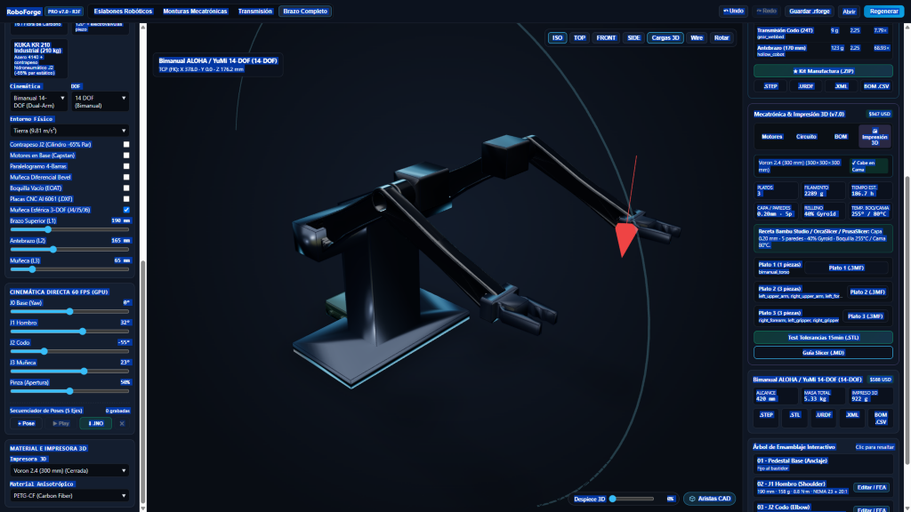
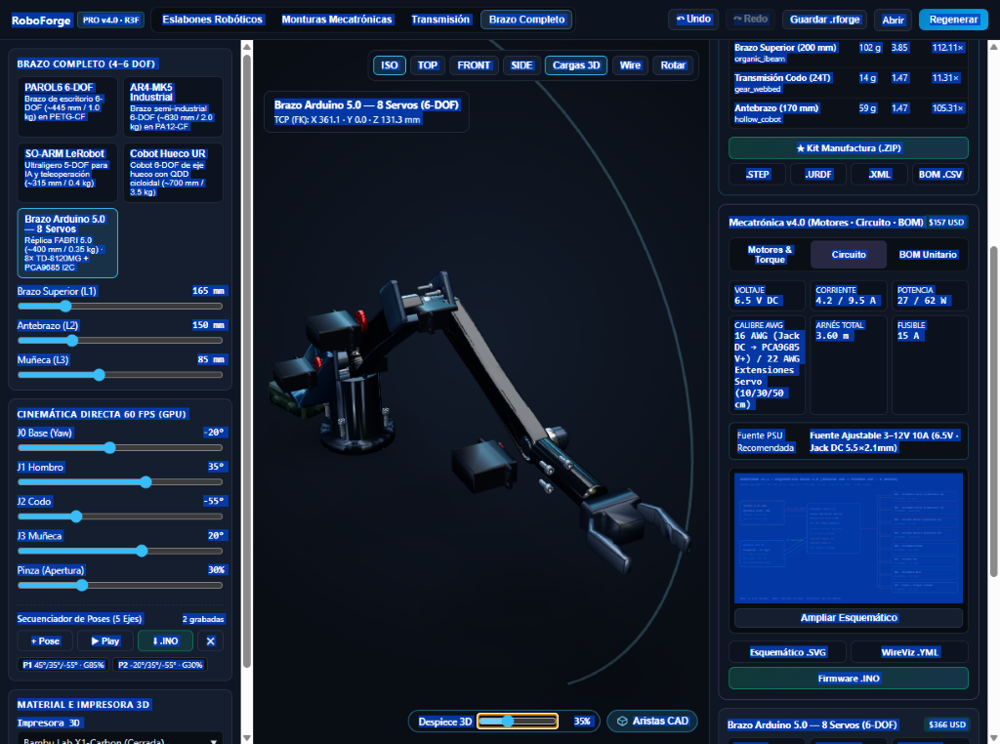
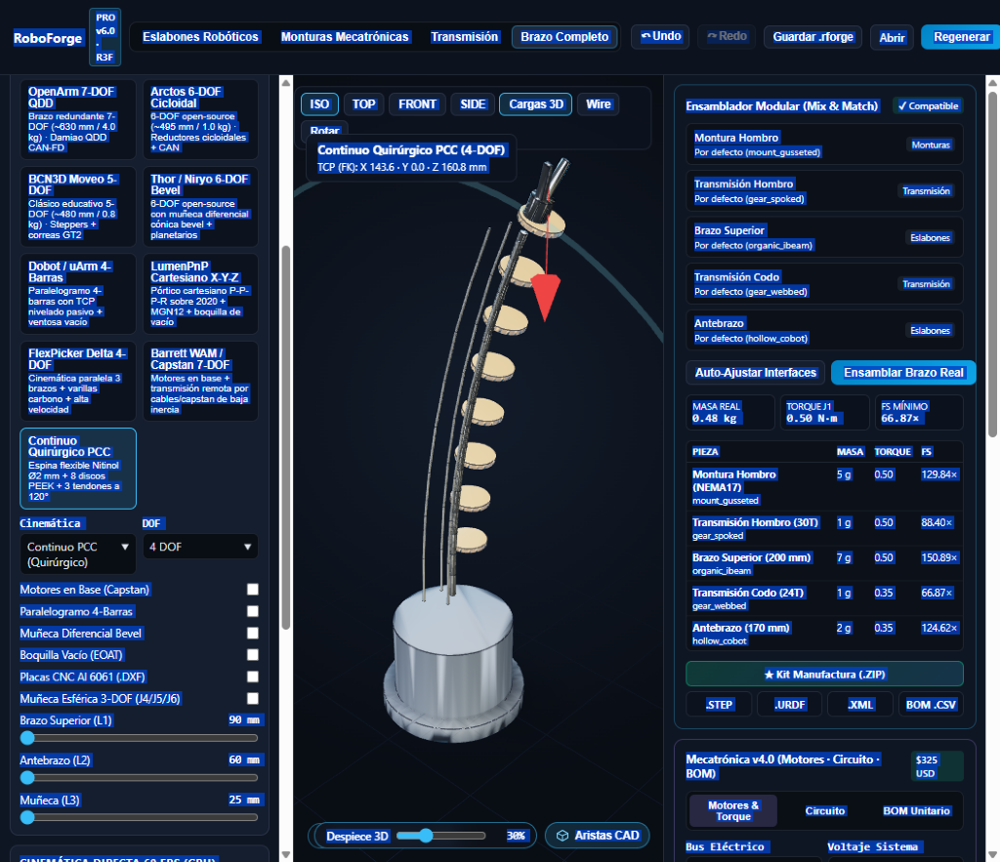

# RoboForge Studio Pro v7.0

[](https://www.python.org/)
[](https://react.dev/)
[](https://github.com/gumyr/build123d)
[](LICENSE)
[](docs/)

**RoboForge Studio Pro** es una plataforma de **ingeniería computacional, CAD paramétrico B-Rep, simulación FEA 3D ortotrópica, mecatrónica y manufactura aditiva** para diseñar, validar y fabricar brazos y sistemas robóticos reales de principio a fin.

Genera geometría manufacturable en **`.STEP`**, **`.STL`**, **`.GLB`**, **`.DXF`** y camas listas para laminar en **`.3MF`** con pruebas de tolerancia, diagramas de cableado WireViz y firmware **`.INO`** autogenerado.

---

## Galería Visual (v7.0)

| Bimanual 14-DOF + Motor de Impresión 3D | Brazo 5-DOF + Circuito Mecatrónico WireViz | Continuum PCC (Tendones + Fuelles TPU) |
| :---: | :---: | :---: |
|  |  |  |

---

## Capacidades Principales (v7.0)

- **8 Topologías Cinemáticas Paramétricas (20 Sistemas · 92.7% promedio de replicabilidad):**
  - Articulado Serial (`6-DOF` / `7-DOF` QDD), `SCARA 4-DOF` (Z prismático), `Delta Paralelo`, `Pórtico Cartesiano (Gantry)`, `Continuum PCC` (tendones + discos espaciadores + fuelles TPU), `Bimanual 14-DOF` (torso dual), `Plataforma Stewart 6-UPS` y mecanismos `4-Bar / Capstan / Bevel`.
- **FEA 3D Ortotrópico y Física Extrema:**
  - Análisis estructural considerando anisotropía de capas FDM ($XY$ vs $Z$), deflexión, torque dinámico, inercia rotacional, entornos **0-G (espacial)** y **ROV submarino** (flotabilidad/arrastre), además de perfiles para polímeros técnicos (`PLA+`, `PETG`, `ABS/ASA`, `PA-CF`, `TPU 95A`) y metales (`Al 6061`, `Ti-6Al-4V`, `Acero 304`).
- **Estructuras Orgánicas y Relleno Biónico Gyroid SDF:**
  - Generación B-Rep real con `build123d` (OpenCASCADE) — vigas biónicas en I, celosías orgánicas, carcasas huecas cobot, reductores cicloidales y planetarios 3D — junto con generación volumétrica **Gyroid SDF** (`scikit-image` + `trimesh`).
- **Ensamblador Modular *Mix & Match*:**
  - Combina bases, articulaciones, eslabones, reductores, monturas estándar (`NEMA 17/23`, `STS3215 LeRobot`, rodamientos `608`/`6805`, insertos térmicos `M3`–`M5`) y efectores finales con validación geométrica y de colisiones.
- **Mecatrónica, Circuitos WireViz y Firmware `.INO`:**
  - Selección asistida de motores/drivers, cálculo de consumo y fuentes, esquemáticos de cableado estilo **WireViz**, exportación de código **Arduino/ESP32 `.INO`** listo para cargar y explorador de base de datos de **20 sistemas robóticos de referencia**.
- **Motor Real de Impresión 3D (DFM + Camas Automáticas):**
  - Empaquetado automático multi-cama en **`build_plate_N.3mf`** (con orientación óptima y separación), pieza de verificación **`calibration_fit_test.stl`** para calibrar holguras reales de tu impresora, y manual personalizado **`PRINT_GUIDE.md`** (orientación, soportes, perímetros, rellenos e insertos).

---

## Instalación y Arranque Rápido

### Requisitos Previos
- **Python 3.12+**
- **Node.js 22+** (para compilar o desarrollar la interfaz React/R3F)
- **Windows 10/11**, Linux o macOS

### 1. Clonar e instalar dependencias

```powershell
git clone https://github.com/<tu-usuario>/roboforge-studio.git
cd roboforge-studio

# Backend Python
python -m venv .venv
.\.venv\Scripts\Activate.ps1
pip install -r backend/requirements.txt

# Frontend React + Three.js (R3F)
cd frontend-react
npm ci
npm run build
cd ..
```

### 2. Ejecutar RoboForge Studio

- **Modo Escritorio Nativo (Windows):**
  Ejecuta `RoboForge_Studio.bat` (o lanza el paquete `roboforge` si lo empaquetaste) para abrir la aplicación en ventana nativa `pywebview`.
- **Modo Servidor Web (`uvicorn`):**
  ```powershell
  .\.venv\Scripts\uvicorn.exe app.main:app --app-dir backend --host 127.0.0.1 --port 8000 --reload
  ```
  Luego abre `http://127.0.0.1:8000` en tu navegador.
- **Modo Desarrollo Frontend (Hot Reload):**
  ```powershell
  cd frontend-react
  npm run dev
  ```

### 3. Empaquetar Ejecutable Standalone Windows (`.exe`)

```powershell
# Asegúrate de haber compilado frontend-react/dist primero (npm run build)
.\.venv\Scripts\pip.exe install pyinstaller pillow
.\.venv\Scripts\python.exe desktop/build_exe.py
```

El ejecutable autocontenido se generará en `dist/RoboForgeStudio/RoboForgeStudio.exe`.

---

## Pruebas Automatizadas

```powershell
# Suite rápida (física, mecatrónica, esquemas, firmware, BD y regresiones v4–v7)
.\.venv\Scripts\python.exe -m pytest -v \
  backend/tests/test_physics.py \
  backend/tests/test_mechatronics_v4.py \
  backend/tests/test_fabri_arm_5.py \
  backend/tests/test_universal_arms_v5.py \
  backend/tests/test_wave2_fixes_v6.py \
  backend/tests/test_wave3_v7.py \
  backend/tests/test_firmware_and_db.py

# Verificación de tipos y build de producción del frontend
cd frontend-react
npx tsc --noEmit && npm run build
```

---

## Roadmap y Lanzamiento

Consulta [docs/GITHUB_RELEASE_ROADMAP.md](docs/GITHUB_RELEASE_ROADMAP.md) para la guía paso a paso de publicación en GitHub, estrategia de ramas/releases y hoja de ruta pública v8.0.

## Licencia

Distribuido bajo licencia **MIT**. Consulta [LICENSE](LICENSE) para más detalles.
