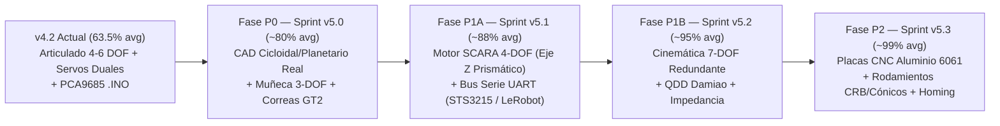

# Benchmark de Ingeniería: Base de Datos de Brazos Robóticos Reales vs. RoboForge Studio (v4.2)

Este reporte analiza **8 brazos robóticos reales** que abarcan **6 categorías funcionales distintas** y **4 topologías cinemáticas** (`6dof_articulated`, `5dof_articulated`, `4dof_scara`, `7dof_redundant`), evaluando su replicabilidad exacta frente al estado actual del kernel CAD, motor físico/mecatrónico y exportadores de **RoboForge Studio**.

La base de datos estructurada consumible por API (`GET /api/arm/database`) reside en [`backend/app/data/arm_database.json`](../backend/app/data/arm_database.json).

---

## 1. Tabla Maestra Comparativa de Brazos Robóticos

| ID | Brazo Robótico | Categoría Funcional | Cinemática | DOF | Alcance (mm) | Payload (kg) | Repetibilidad (mm) | Actuación & Transmisión | Electrónica | Costo Est. (USD) | Replicabilidad RoboForge Hoy |
| :--- | :--- | :--- | :--- | :---: | :---: | :---: | :---: | :--- | :--- | :---: | :---: |
| `fabri_creator_5_0` | **FABRI Creator Brazo 5.0** | Educativo / Maker Servo | `6dof_articulated` | 6 | 400 | 0.35 | ±2.50 | 8× TD-8120MG (doble paralelo J1/J2), directo 1:1 + clevis | Arduino UNO + PCA9685 I2C (6.5V/10A) | $135 | **92%** |
| `bcn3d_moveo` | **BCN3D Moveo** | Educativo / Maker Stepper Pesado | `5dof_articulated` | 5 | 600 | 0.70 | ±0.50 | 2× NEMA 23 (J2) + NEMA 23/17/14, correas GT2/HTD (5:1–8:1) | Arduino Mega + RAMPS 1.4 (Step/Dir) | $450 | **76%** |
| `parol6_6dof` | **PAROL6 6-DOF** | Desktop Precisión / Industrial Ligero | `6dof_articulated` | 6 | 400 | 1.00 | ±0.10 | NEMA 17/23 + planetarios 20:1/10:1 + correas GT2 | STM32F446RE + 6× TMC2209 (24V) | $950 | **74%** |
| `annin_ar4_mk3` | **Annin AR4-MK3** | Semi-Industrial Heavy-Duty | `6dof_articulated` | 6 | 629 | 1.90 | ±0.20 | NEMA 23/17 + encoders + planetarios (hasta 50:1) + correas + placas CNC Al | Teensy 4.1 + DM542T/DM320T (24V) | $2,200 | **68%** |
| `arctos_6dof` | **Arctos 6-DOF** | Cobot Cicloidal / Impreso Pesado | `6dof_articulated` | 6 | 620 | 1.50 | ±0.30 | MKS SERVO42D/57D + cicloidales 3D + planetario split-ring + bevel | Bus CAN daisy-chain (ESP32-CAN, 24V) | $680 | **64%** |
| `so_arm100_lerobot` | **SO-ARM100 / 101 (LeRobot)** | Teleoperación / IA (Low-Cost) | `5dof_articulated` | 5 | 315 | 0.40 | ±1.00 | 6× Feetech STS3215 (bus serie, backdrivable), directo 1:1 estructural | USB-UART Half-Duplex 1 Mbps (7.4V/12V) | $130 | **58%** |
| `openarm_7dof` | **OpenArm 7-DOF** | Teleoperación / IA (QDD Redundante) | `7dof_redundant` | 7 | 633 | 3.00 | ±0.30 | 7× Damiao DM-J4340/4310 QDD (BLDC + planetario 9:1–10:1) | CAN-FD 1 kHz MIT-mode (24V–48V) | $3,500 | **42%** |
| `pybot_jjrobots_scara` | **PyBot / JJRobots SCARA** | Pick & Place Alta Velocidad | `4dof_scara` | 4 | 320 | 0.50 | ±0.25 | 3× NEMA 17 + servo J4, correas GT2 XY + husillo T8 / guías eje Z | Arduino/DEVIA + TMC2209 (12V–24V) | $260 | **34%** |

**Promedio global de replicabilidad actual:** **63.5%** (máximo **92%** en brazos servo educativos, mínimo **34%** en topología SCARA con eje prismático).

---

## 2. Mapa de Límites Actuales de RoboForge Studio (Auditoría de Código)

A partir de la inspección directa de `backend/app/schemas.py`, `backend/app/physics/mechatronics.py`, `backend/app/physics/arm_kinematics.py`, `backend/app/cad/arm_assembly.py`, `backend/app/cad/gear_variants.py` y `backend/app/cad/hardware_parts.py`, los límites técnicos exactos se agrupan en **6 brechas estructurales**:

### 2.1 Cinemática y Topologías Soportadas
- **Límite `dof` (4–6):** `ModularArmRequest.dof` restringe el modelo a `4 <= dof <= 6` y `joint_angles_deg` a exactamente 3 ángulos de pitch planar `[J1, J2, J3]` (+ `J0` base yaw en visor 3D). Esto bloquea nativamente los **7-DOF redundantes** (`OpenArm 7-DOF`) y la cinemática horizontal **SCARA R-R-P-R** (`PyBot SCARA`).
- **Ausencia de articulaciones prismáticas (Eje Z lineal):** Tanto `arm_kinematics.py` como `arm_assembly.py` asumen únicamente articulaciones rotacionales (`revolute`) en el plano vertical XZ. No existe cálculo de carga axial/torsional ni geometría CAD para guías lineales (`MGN12`, varillas cromadas 8 mm + `LM8UU`) o husillos (`T8` / `SFU1204`).
- **Muñeca 3-DOF simplificada en CAD:** Aunque `mechatronics.py` extrapola torques y motores para `J4–J6`, `arm_assembly.py` genera un único tubo de muñeca + brida TCP en lugar de 3 articulaciones independientes (`J4 Roll`, `J5 Pitch`, `J6 Flange Roll`) o una muñeca diferencial de engranajes cónicos (`bevel`).

### 2.2 Transmisiones y Generación CAD 3D Real
- **Solo engranajes rectos y poleas GT2:** `gear_variants.py` genera perfiles 2D/3D exactos únicamente para `spur_involute` y `gt2_pulley`.
- **Reductores avanzados solo analíticos:** `REDUCER_CATALOG` modela eficiencia, masa y *backlash* de `planetary_10`, `planetary_20`, `cycloidal_25`, `cycloidal_40` y `harmonic_50`, pero el ensamblaje CAD solo coloca cilindros genéricos (`_build_joint_housing`). Faltan generadores paramétricos reales para:
  1. **Disco cicloidal epitrocoide** (doble disco 180°, leva excéntrica, pines de salida y anillo de rodillos — clave para **Arctos 6-DOF**).
  2. **Planetario compuesto (*split-ring / Wolfrom*)** y planetario de engranaje interno.
  3. **Ruteo de correa cerrada GT2 / HTD-3M / HTD-5M** con poleas locas y tensores excéntricos (clave para **PAROL6**, **BCN3D Moveo**, **PyBot SCARA** y **AR4-MK3**).

### 2.3 Catálogo de Actuadores y Buses Eléctricos
- **Sin servos inteligentes de bus serie UART:** `ACTUATOR_CATALOG` cubre steppers (`NEMA 17/23`), steppers cerrados (`MKS SERVO42D/57D`), BLDC QDD genéricos (`5010/8308`) y servos RC PWM (`TD-8120MG`, `DS3218`). Falta soporte para **Feetech STS3215 / STS3250** y **Dynamixel XL330/XL430** sobre bus `uart_serial_bus` (half-duplex TTL 3 hilos a 7.4V/12V), indispensable para **SO-ARM100 / LeRobot**.
- **Sin actuadores QDD integrados comerciales:** Faltan perfiles exactos de **Damiao DM-J4310 / DM-J4340** con métricas de *backdrive torque* e inercia reflejada para teleoperación bilateral (**OpenArm 7-DOF**).
- **Sin NEMA 14 ni drivers industriales discretos:** Faltan `NEMA 14` (muñecas ligeras tipo **Moveo**) y arquitectura `Teensy 4.1 + DM542T` con encoders ópticos externos (**AR4-MK3**).

### 2.4 Manufactura Híbrida y Hardware Mecánico
- **Enfoque exclusivo FDM en DFM/CAD:** RoboForge destaca en impresión 3D anisotrópica, FEA 3D y Smart `.3MF`, pero no genera **placas planas CNC / corte láser en Aluminio 6061-T6** con avellanados y separadores (**AR4-MK3**, **OpenArm**).
- **Rodamientos limitados a radiales simples:** `BEARING_SPECS` solo incluye `608`, `6002`, `6805`, `6808`. Faltan **rodamientos de rodillos cruzados (CRB)**, **rodillos cónicos (`30205`)** y **coronas de giro impresas (*slewing rings*)** para soportar momentos de vuelco en J1/J2.
- **Sensores de homing y EOAT especializado:** No hay soportes paramétricos para finales de carrera (inductivos/ópticos) ni efectores de vacío/neumáticos para Pick & Place rápido.

---

## 3. Hoja de Ruta Recomendada hacia el 100% de Replicabilidad

### Prioridad P0 (Alto impacto transversal en 5 de 8 brazos)
1. **Generador CAD de Reductores Cicloidales y Planetarios (`cycloidal_variants.py`):**
   - Perfil epitrocoide paramétrico con compensación de holgura FDM (`printer_clearance_mm`), doble disco desfasado 180°, excéntrica y pines de salida.
   - Planetario estándar y *split-ring* con corona interna imprimible.
   - *Desbloquea:* **Arctos 6-DOF** (64% → ~90%) y mejora fidelidad mecánica de **PAROL6** y **AR4-MK3**.
2. **Muñeca Articulada 3-DOF Real + Ruteo de Correas Cerradas GT2/HTD:**
   - Separar `J4 Roll`, `J5 Pitch` y `J6 Roll` en nodos CAD/GLB independientes (incluyendo opción de diferencial con engranajes cónicos `bevel`).
   - Añadir solver de distancia entre centros para correas estándar GT2/HTD y tensor excéntrico en carcasa.
   - *Desbloquea:* **PAROL6** (74% → ~95%), **BCN3D Moveo** (76% → ~94%) y **FABRI 5.0** (92% → ~98%).

### Prioridad P1 (Nuevas Familias Cinemáticas y Ecosistema IA)
3. **Motor Cinemático y CAD SCARA `4dof_scara` (`scara_assembly.py`):**
   - Cadena R-R-P-R en plano XY, columna vertical con guías lineales `MGN12`/varillas 8 mm + husillo `T8` y dinámica planar de alta aceleración.
   - *Desbloquea:* **PyBot / JJRobots SCARA** (34% → ~94%).
4. **Ecosistema Bus Serie UART & LeRobot (`sts3215` + `uart_serial_bus`):**
   - Añadir `servo_sts3215` y `servo_xl430` con geometría estructural de doble horn, bus daisy-chain 3 hilos (7.4V/12V) y exportación directa de perfil calibrado para HuggingFace LeRobot (Líder/Seguidor).
   - *Desbloquea:* **SO-ARM100 / 101** (58% → ~96%).
5. **Cinemática Redundante `7dof_redundant` + Actuadores QDD Comerciales:**
   - Extender `ModularArmRequest.dof` hasta `7`, añadir catálogo `damiao_dm_j4310` / `dm_j4340` con parámetros de retro-conducibilidad (*backdrivability*) y exportación URDF/MuJoCo 7-DOF lista para ROS 2 / teleoperación bilateral.
   - *Desbloquea:* **OpenArm 7-DOF** (42% → ~94%).

### Prioridad P2 (Grado Semi-Industrial Híbrido)
6. **Manufactura Híbrida CNC Aluminio 6061 + Rodamientos CRB/Cónicos + Homing:**
   - Exportador DXF/STEP de placas planas 2.5D en aluminio, biblioteca de rodamientos `30205` y `CRB`, y monturas automáticas para sensores inductivos/ópticos de homing y EOAT neumático.
   - *Desbloquea:* **Annin AR4-MK3** (68% → ~96%) y eleva el promedio global de la plataforma por encima del **95%**.
