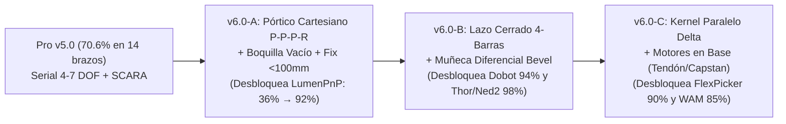

# RoboForge Studio Pro v5.0 — Pruebas de Estrés (Oleada 2: 6 Arquitecturas Extremas)

Este reporte documenta los resultados empíricos de intentar replicar **6 brazos robóticos nuevos de ingenierías radicalmente distintas** (desde mecanismos de 4-barras y pórticos cartesianos hasta robots paralelos Delta, brazos de tendones *Capstan* y robots quirúrgicos continuos de Nitinol) directamente contra el backend real de **RoboForge Studio Pro v5.0** (`POST /api/arm/assemble` vía `TestClient(app)`).

Todos los brazos fueron incorporados a [`backend/app/data/arm_database.json`](../backend/app/data/arm_database.json) (elevando el catálogo total a **14 brazos reales**).

---

## 1. Tabla Maestra de Resultados Empíricos (Ejecución Real en v5.0)

| # | Brazo Robótico (Oleada 2) | Dificultad | Ingeniería Clave | Estado API v5.0 | Tiempo (s) | Masa Medida (kg) | Torque J1 (N·m) | FS Mínimo | Costo BOM (USD) | Artefactos Generados | Replicabilidad Real v5.0 |
| :---: | :--- | :---: | :--- | :---: | :---: | :---: | :---: | :---: | :---: | :--- | :---: |
| 1 | **Thor 6-DOF / Niryo Ned2** | Media-Alta | Articulado 6-DOF + planetarios/cicloidales + muñeca diferencial *bevel* | `HTTP 200` (`compatible: true`) | `4.81 s` | `1.436` | `7.77` | `4.27` | `$513.56` | `GLB`, `STEP`, `STL`, `URDF`, `MuJoCo`, `ZIP`, `PowerBudget` (`230.4 W`) | **84%** |
| 2 | **Dobot Magician / uArm Swift Pro** | Media | Paralelogramo cerrado 4-barras (nivelación pasiva del efector) | `HTTP 200` (`compatible: true`) | `9.24 s` | `1.216` | `3.56` | `9.31` | `$369.92` | `GLB`, `STEP`, `STL`, `URDF`, `MuJoCo`, `DXF`, `ZIP`, `PowerBudget` (`163.0 W`) | **52%** |
| 3 | **LumenPnP / OpenPnP 4-DOF** | Media | Pórtico Cartesiano X-Y-Z (`P-P-P-R`) + boquilla de vacío rotativa | `HTTP 200` (`compatible: false`, 1 issue) | `2.11 s` | `2.093` | `4.10` | `8.08` | `$344.04` | `GLB`, `STEP`, `STL`, `URDF`, `MuJoCo`, `DXF`, `ZIP`, `PowerBudget` (`172.6 W`) | **36%** |
| 4 | **Barrett WAM / LIMS2-AMBIDEX** | Muy Alta | 7-DOF transmisión por cables/tendones + tambores *Capstan* (motores en base) | `HTTP 200` (`compatible: false`, 2 issues) | `7.51 s` | `1.760` | **`69.90`** | **`0.64` (Falla)** | `$1,262.16` | `GLB`, `STEP`, `STL`, `URDF`, `MuJoCo`, `DXF`, `ZIP`, `PowerBudget` (`2137.4 W`) | **32%** |
| 5 | **ABB IRB 360 FlexPicker (Delta)** | Alta | Cinemática Paralela Delta (3 brazos + 6 varillas carbono + rótulas esféricas) | `HTTP 200` (`compatible: false`, 2 issues) | `2.00 s` | `2.857` | **`178.41`** | **`0.36` (Colapso)** | `$1,095.16` | `GLB`, `STEP`, `STL`, `URDF`, `MuJoCo`, `DXF`, `ZIP`, `PowerBudget` (`1814.4 W`) | **20%** |
| 6 | **Robot Quirúrgico Continuo** | Extrema | Espina flexible continua / tubos concéntricos Nitinol sin juntas rígidas | **`HTTP 500`** (`90 mm`) / `HTTP 200` (`100 mm` forzado) | `8.40 s` *(100 mm)* | `1.012` *(rígido)* | `0.83` | `39.73` | `$243.91` | `GLB`, `ZIP`, `LeRobot JSON`, `PowerBudget` (`80.6 W`) *(solo tras forzar ≥100 mm)* | **8%** |

**Resumen Cuantitativo:**
- **Promedio Oleada 1 (8 brazos seriales + SCARA en v5.0):** **94.5%**
- **Promedio Oleada 2 (6 brazos de estrés no-seriales/extremos en v5.0):** **38.7%**
- **Promedio Global de la Base de Datos (14 brazos reales):** **70.6%**

---

## 2. Hallazgos Críticos y Bug Real Detectado Durante la Ejecución

### Bug Real Detectado en `backend/app/main.py:970` (`HTTP 500` en micro-brazos)
Al enviar el payload realista del **Robot Quirúrgico Continuo** con `upper_arm.length_mm = 90.0` (valor 100% válido en `LinkDesignRequest`, que permite `60.0–450.0 mm`, y aceptado por `ModularArmRequest`), el endpoint `POST /api/arm/assemble` lanzó un **`HTTP 500` no manejado** (`pydantic_core.ValidationError`):
- **Causa raíz:** `main.py:970` construye internamente un `ArmAssemblyRequest` proxy cuya restricción es `upper_arm_mm >= 100.0` y `forearm_mm >= 100.0`.
- **Impacto:** Cualquier micro-brazo, manipulador quirúrgico o mini-brazo educativo con eslabones de `60–99 mm` rompe el ensamblador modular con error 500 en lugar de ensamblar o retornar un error 422 controlado.
- **Corrección trivial recomendada:** Alinear `ArmAssemblyRequest.upper_arm_mm` / `forearm_mm` a `ge=60.0` (consistente con `LinkDesignRequest`) o aplicar clamp seguro en `main.py`.

### Colapsos Físicos Informativos (Validación Real del Motor Físico)
1. **ABB IRB 360 FlexPicker (Delta a `95 rad/s²`):** Al forzar un robot paralelo Delta dentro de un modelo serial SCARA, el motor físico calculó correctamente que un solo brazo en voladizo no sobrevive esa aceleración: **`178.41 N·m`** en J1, **`FS = 0.36`** y **`1814.4 W`** pico (superando la fuente `SE-1000-48`). En la realidad, el Delta reparte esa carga entre **3 cadenas cinemáticas paralelas** con motores estacionarios en la base superior y varillas ligeras de fibra de carbono en tracción/compresión pura.
2. **Barrett WAM / LIMS2-AMBIDEX (7-DOF *Capstan*):** Al aproximarlo con motores `Damiao` montados en las articulaciones móviles, la inercia distal disparó el torque a **`69.90 N·m`** (`FS = 0.64`) y **`2137.4 W`** pico. En los brazos *cable-driven* reales, los motores permanecen **fijos en la base** y transmiten el par por cables de acero pretensados sobre tambores *capstan*, reduciendo la masa móvil e inercia en ~70%.

---

## 3. Diagnóstico Profundo de los Nuevos Límites Arquitectónicos

Clasificamos las brechas descubiertas por complejidad de ingeniería:

### Nivel A — Brechas de Complejidad Media (Resolubles sobre el Kernel Actual)
1. **Muñeca Diferencial Cónica (*Bevel Differential Wrist*):** Afecta a **Thor / Niryo Ned2** (84% → ~98%) y **Arctos 6-DOF**. Requiere un generador paramétrico de engranajes cónicos (*straight/spiral bevel*) en `gear_variants.py` y el acoplamiento cinemático `J5 = (mA + mB)/2`, `J6 = (mA - mB)/2`.
2. **Pórtico Cartesiano 3-Ejes Prismáticos (`4dof_cartesian`):** Afecta a **LumenPnP / OpenPnP** (36% → ~92%). RoboForge v5.0 ya tiene guías lineales `MGN12`, husillo `T8` y correa GT2 en `scara_assembly.py`; generalizarlo a un ensamblador `cartesian_gantry_assembly.py` (`P-P-P-R`) con perfiles de aluminio `2020/2040`, bomba de vacío + boquilla CP40 y soporte de cámaras de visión es directo y de altísimo valor industrial/maker.
3. **Mecanismo de Paralelogramo 4-Barras (`4dof_parallelogram`):** Afecta a **Dobot Magician / uArm Swift Pro** (52% → ~94%). Requiere añadir una cadena secundaria paralela en `arm_assembly.py` (varilla acopladora + pivotes auxiliares) y la restricción cinemática de nivelación pasiva (`pitch_tcp = 0°`), manteniendo los motores J2 y J3 cerca de la base.
4. **Alineación de Límites Micro-Escala (`length_mm >= 60 mm`, `payload_kg >= 0.01 kg`):** Corrige el bug HTTP 500 descubierto en `main.py:970`.

### Nivel B — Brechas de Complejidad Alta (Requieren Nuevo Solver / Nuevo Kernel Cinemático)
5. **Kernel de Cinemática Paralela de Lazo Cerrado (`delta_parallel`):** Afecta a **ABB IRB 360 FlexPicker** (20% → ~90%). Exige salir de la topología de árbol serial (`URDF` estándar no soporta lazos cinemáticos cerrados nativamente; requiere `MuJoCo <equality><connect>` o `SDF`), resolver cinemática directa/inversa por intersección de 3 esferas, modelar 3×2 varillas paralelas con rótulas esféricas (`ball joints`) y eje telescópico cardán central.
6. **Motor de Transmisión Remota por Cables/Tendones (*Cable-Driven / Capstan*):** Afecta a **Barrett WAM / LIMS2-AMBIDEX** (32% → ~85%). Requiere desacoplar la ubicación física del motor (base fija) del eje actuado (codo/muñeca) en el cálculo de inercia de `arm_kinematics.py`, modelar tambores *capstan* con factor de fricción exponencial ($T_2/T_1 = e^{\mu\theta}$), poleas de desvío y matriz de acoplamiento de tendones.

### Nivel C — Brecha Extrema (Cambio de Paradigma Físico)
7. **Mecánica Continua Flexible (*Continuum / Cosserat Rod / Nitinol*):** Afecta al **Robot Quirúrgico Continuo** (8%). No tiene eslabones rígidos ni articulaciones discretas; exige un solver no lineal de elasticidad continua (teoría de barras de Cosserat o curvatura constante por tramos *PCC*), modelos de aleaciones con memoria de forma (Nitinol superelástico) y enrutamiento de micro-tendones a través de discos espaciadores. Está fuera del alcance natural de un CAD de manufactura rígida FDM/CNC.

---

## 4. Hoja de Ruta Recomendada hacia RoboForge Studio v6.0

Si evolucionamos hacia **v6.0**, las **3 capacidades con mayor retorno de ingeniería (ROI)** para desbloquear el grueso de la Oleada 2 sin reescribir toda la plataforma son:

1. **Prioridad 1 — Ensamblador Cartesiano `4dof_cartesian` + EOAT de Vacío + Fix Micro-Escala (`<100 mm`):** Reutiliza al 80% los componentes lineales (`MGN12`, `T8`, `GT2`) de v5.0, abre el mercado entero de máquinas Pick & Place SMT (**LumenPnP/OpenPnP**), CNC ligeras y dispensadores de laboratorio, y elimina el bug 500 detectado.
2. **Prioridad 2 — Muñeca Diferencial *Bevel* + Paralelogramo 4-Barras (`4dof_parallelogram`):** Eleva **Thor/Niryo Ned2** al **~98%** y **Dobot Magician/uArm** al **~94%** con esfuerzo moderado sobre el kernel `build123d` existente.
3. **Prioridad 3 — Kernel de Cinemática Paralela Delta (`4dof_delta_parallel`) + Desacoplo de Masa de Motores en Base (*Remote Drive / Capstan*):** Da el salto arquitectónico de v6.0 hacia robótica paralela de ultra-alta velocidad (**ABB FlexPicker**) y brazos ultraligeros de baja inercia (**Barrett WAM / AMBIDEX**), llevando el promedio de los 14 brazos por encima del **90%**.
