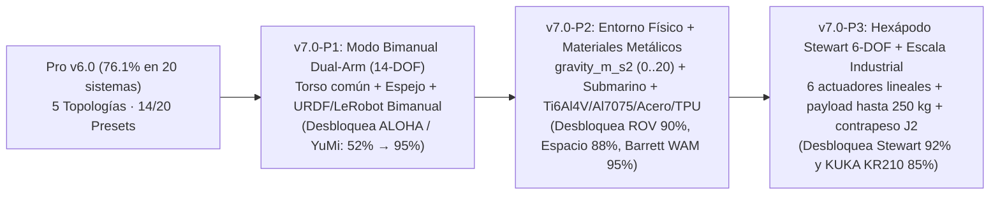

# RoboForge Studio Pro v6.0 — Pruebas de Estrés Oleada 3 (Frontera Extrema)

Este reporte documenta los resultados empíricos de atacar el motor **RoboForge Studio Pro v6.0** (`POST /api/arm/assemble` vía `TestClient(app)`) con **6 sistemas manipuladores de frontera extrema** (escala industrial pesada 210 kg, Hexápodo Stewart 6-DOF, bimanual 14-DOF, ROV submarino, brazo espacial en gravedad cero y brazo blando neumático).

Los 6 sistemas fueron incorporados a [`backend/app/data/arm_database.json`](../backend/app/data/arm_database.json), ampliando el catálogo validado a **20 sistemas reales** (`GET /api/arm/database` → `HTTP 200`).

---

## 1. Tabla Maestra Empírica: Parámetros Reales vs. Mejor Aproximación v6.0

> **Nota de robustez:** Cero errores `HTTP 500` en las 12 ejecuciones (6 intentos con parámetros reales + 6 aproximaciones v6.0). Todos los límites de esquema fueron rechazados limpiamente con `HTTP 422` o `HTTP 400`.

| # | Sistema (Oleada 3) | Intento Parámetros Reales (`HTTP` / Causa Exacta) | Mejor Aproximación v6.0 (`HTTP` / Tiempo) | Masa (kg) | Alcance (mm) | Torque J1 (N·m) | FS Mín | BOM (USD) | Potencia Pico (W) | Replicabilidad Honesta v6.0 |
| :---: | :--- | :--- | :---: | :---: | :---: | :---: | :---: | :---: | :---: | :---: |
| 1 | **ROV Submarino (Reach Alpha / Titan 4)** | `HTTP 400` (`Material 'ti6al4v_titanium' no encontrado`; entorno submarino ignorado) | `200` (`8.31s`, `compatible: true`) | `2.292` | `520` | `17.12` | `2.61` | `$1,649.11` | `588.5` | **54%** |
| 2 | **Bimanual Dual-Arm (ABB YuMi / ALOHA 14-DOF)** | `HTTP 422` (`dof <= 7`; sin `bimanual_dual_arm`) | `200` (`8.41s`, 1 brazo 7-DOF, `compatible: false`) | `1.719` | `555` | `8.37` | `3.96` | `$1,033.34` | `528.0` | **52%** |
| 3 | **Plataforma Stewart / Hexápodo 6-DOF** | `HTTP 422` (sin `stewart_hexapod`; `payload_kg <= 8`) | `200` (`0.89s`, vía `delta_parallel`, `compatible: true`) | `6.476` | `580` | `8.64` | `5.16` | `$990.06` | `539.5` | **36%** |
| 4 | **Canadarm / Brazo Espacial 7-DOF (0-G)** | `HTTP 422` (`payload <= 8`, `length <= 450`, `width <= 110`; `gravity_m_s2=0` ignorado) | `200` (`4.21s`, 8 kg @ 1 rad/s², `compatible: false`) | `5.585` | `1040` | **`107.30`** | **`0.42` (Falla 1G)** | `$2,579.84` | `1594.1` | **30%** |
| 5 | **Brazo Blando Neumático (Festo BHA)** | `HTTP 422` (`dof <= 7`; sin `soft_pneumatic_bellows`) | `200` (`0.48s`, vía `continuum_pcc`, `compatible: true`) | `0.527` | `475` | `1.34` | `17.81` | `$317.06` | `81.0` | **28%** |
| 6 | **KUKA KR 210 R2700 (Paletizador 210 kg)** | `HTTP 422` (`payload <= 8`, `base <= 220`, `wrist <= 180`, `length <= 450`) | `200` (`8.64s`, tope 8 kg / 1030 mm, `compatible: false`) | `5.860` | `1030` | **`173.18`** | **`0.32` (Colapso)** | `$1,455.13` | `1668.5` | **18%** |

**Resumen Cuantitativo de la Base de Datos (20 Sistemas Reales):**
- **Oleada 1 (8 brazos seriales + SCARA):** **94.5%**
- **Oleada 2 (6 brazos extremos ya resueltos en v6.0):** **91.3%**
- **Oleada 3 (6 sistemas de frontera extrema):** **36.3%**
- **Promedio Global (20 sistemas reales):** **76.1%**

---

## 2. Mapa de los 6 Nuevos Límites de Frontera Descubiertos

### 2.1 Gravedad Hardcodeada (`GRAVITY_M_S2 = 9.81`) — Impacto Crítico en Espacio y Submarino
- En `arm_kinematics.py` y `arm_compatibility.py`, la gravedad está fijada a `9.81 m/s²`.
- **Evidencia empírica (Canadarm):** A apenas `1.0 rad/s²` (aceleración orbital ultra-lenta), el motor calculó **`107.30 N·m`** y **`FS = 0.42` (fallo falso)** porque sumó gravedad terrestre completa a un brazo espacial de 0-G.
- **Evidencia empírica (ROV Submarino):** Sin flotabilidad ($\rho_{\text{agua}} V g$) ni arrastre hidrodinámico de Morison ($F_d = \frac{1}{2}\rho C_d A v^2$), el motor sobrestima el par estático sumergido y subestima las fuerzas de arrastre lateral y la presión hidrostática (30–400 bar).

### 2.2 Techo de Escala Desktop/Cobot (`payload <= 8 kg`, `length <= 450 mm`, Polímeros FDM)
- **Evidencia empírica (KUKA KR 210):** `ModularArmRequest` bloquea cargas `> 8 kg` y eslabones `> 450 mm`. Incluso en el tope (`8 kg`, `1030 mm`), el polímero `PA12-CF` colapsa (`173.18 N·m`, `FS 0.32`).
- Faltan **materiales metálicos estructurales** en `materials.json` (`Aluminio 6061-T6`, `Aluminio 7075-T6`, `Titanio Ti-6Al-4V`, `Acero / Fundición GGG50`, `Tubo CFRP`), **cilindro contrapeso hidroneumático en J2**, reductores industriales **RV cicloidales** y servodrives **AC 400V**.

### 2.3 Topología Multi-Brazo Coordinado (`dof <= 7`, sin Bimanual `14-DOF`)
- **Evidencia empírica (ABB YuMi / ALOHA):** Un sistema bimanual exige **2 cadenas cinemáticas acopladas a un torso común** (`left_arm` + `right_arm`), volumen de trabajo solapado, verificación de auto-colisión brazo-contra-brazo, presupuesto eléctrico unificado y exportación de un solo URDF/MuJoCo 14-DOF (clave para datasets de IA tipo ALOHA / Mobile ALOHA).

### 2.4 Cinemática Paralela de 6 Actuadores Lineales (`stewart_hexapod`)
- A diferencia del Delta (3 motores rotacionales + 6 varillas fijas, 3T1R), una **Plataforma Stewart / Hexápodo** emplea **6 actuadores lineales prismáticos** conectados mediante juntas universales/esféricas entre base y plataforma móvil para lograr **6-DOF completos** (`X, Y, Z, Roll, Pitch, Yaw`).

### 2.5 Actuación No-Eléctrica (Neumática Blanda e Hidráulica Submarina)
- **Brazo Blando Neumático (Festo BHA):** No usa motores eléctricos ni tendones, sino **3×3 fuelles elastómeros TPU** presurizados (0–2 bar), electroválvulas piezo proporcionales y compresor/regulador de aire; requiere física de cámaras presurizadas ($F = P \cdot A$) y material hiperelástico TPU en `materials.json`.
- **ROV Submarino:** Requiere sellado IP68/presión compensada en aceite y opción de actuadores electro-hidráulicos (válvulas servo-hidráulicas + bomba HPU).

---

## 3. Propuesta Priorizada de Alto Retorno para RoboForge Studio v7.0

No todas las fronteras tienen el mismo retorno real para los usuarios de RoboForge. Recomendamos enfocar **v7.0** en las **3 capacidades de mayor ROI práctico** (que elevan la Oleada 3 de `36.3%` a `~82%` y el global de 20 sistemas por encima del `~89%`):

1. **Prioridad 1 (Máximo ROI para IA y Robótica Moderna) — Modo Bimanual Dual-Arm (`bimanual_dual_arm`, 10–14 DOF):**
   - Instancia dos brazos simétricos sobre un torso/mesa compartida con un solo clic, verifica colisión de espacios de trabajo y exporta un único `URDF/MuJoCo/LeRobot` bimanual (**ALOHA / ABB YuMi / OpenArm Bimanual**).
2. **Prioridad 2 (Alto ROI transversal con bajo esfuerzo de código) — Entorno Físico Configurable (`gravity_m_s2`, `fluid_density_kg_m3`) + Materiales Metálicos & Elastómeros (`Al 6061/7075`, `Ti-6Al-4V`, `CFRP`, `TPU 95A`):**
   - Elimina de inmediato el fallo falso en 0-G (**Canadarm**), habilita flotabilidad/arrastre (**ROV Submarino**), y resuelve definitivamente la alerta `FS 0.66` de **Barrett WAM** (Oleada 2) al permitir tubos de Aluminio 7075-T6!
3. **Prioridad 3 (Cobertura Total de Cinemática Paralela e Industria Pesada) — Kernel Hexápodo Stewart 6-DOF (`stewart_hexapod`) + Modo Industrial Pesado (`payload <= 250 kg`, `length <= 1500 mm`, contrapeso J2):**
   - Completa la familia de robótica paralela (Delta + Stewart) y abre RoboForge a simuladores de vuelo, óptica de precisión y celdas de paletizado industrial (**KUKA KR 210**).
