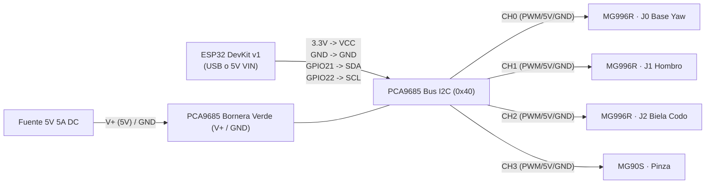

# Guía Práctica de Fabricación y Ensamble: **RoboForge Mars-Mini**

**RoboForge Mars-Mini** es el brazo robótico demostrador **4-DOF Paralelogramo 4-Barras + Pinza** diseñado nativamente en **RoboForge Studio Pro v7.1** para imprimirse al **100% en una Elegoo Mars 5 Ultra** (`153.36 × 77.76 × 165 mm`, resina ABS-Like 9K) con un presupuesto total de materiales inferior a **$40 USD** y control **Wi-Fi desde el celular** (sin instalar apps extra).

| Especificación | Valor |
| :--- | :--- |
| **Topología** | 4-DOF Paralelogramo 4-Barras (`four_bar_parallelogram`) + Pinza 1-DOF |
| **Alcance / Payload** | `250 mm` (`L1=105 mm`, `L2=100 mm`, `L3=45 mm`) · `150 g` útiles |
| **Impresora Objetivo** | **Elegoo Mars 5 Ultra** (`153.36 × 77.76 × 165 mm`, MSLA 9K) — *0 piezas fuera de cama* |
| **Material** | Resina **ABS-Like** (~180 g en 2 platos, ~2.5 horas totales) |
| **Electrónica y Control** | **ESP32 DevKit v1** + **PCA9685 I2C** + Servidor Web Wi-Fi integrado (`5V 5A`) |
| **Costo Total Estimado** | **`~$39.50 USD`** |

---

## 1. Lista de Compras Económica (~$39.50 USD)

| Cantidad | Componente | Uso en Mars-Mini | Costo Est. (USD) |
| :---: | :--- | :--- | :---: |
| 3 | **Servo MG996R** (engranes metálicos, 10 kg·cm) | `CH0` Base Yaw, `CH1` Hombro, `CH2` Biela Codo (en base) | $10.50 |
| 1 | **Micro-servo MG90S** (engranes metálicos) | `CH3` Pinza paralela compacta | $2.00 |
| 1 | **ESP32 DevKit v1** (30 o 38 pines, USB-C/Micro) | Controlador Wi-Fi + servidor web + I2C | $5.50 |
| 1 | **Módulo PCA9685** (16 canales PWM I2C) | Generación PWM limpia 50 Hz para los 4 servos | $3.00 |
| 1 | **Fuente Conmutada 5V 5A** + jack barril DC + cables Dupont | Alimentación exclusiva de servos (evita reinicios del ESP32) | $9.50 |
| 1 | **Kit tornillos M2×8 (4×, para MG90S) + M3 (M3×10, M3×16, M3×25)** + **tuercas cautivas hexagonales M3** (`ISO 4032`) + **1× rodamiento 608** | Ensamble sin autorroscantes (cero grietas en resina) | $3.30 |
| ~180 g | **Resina ABS-Like** (Elegoo ABS-Like 3.0 / Sunlu ABS-Like) | Todas las piezas estructurales + pinza + test de tolerancias | $6.00 |
| | **TOTAL ESTIMADO** | | **$39.50 USD** |

> **Regla de Oro en Resina:** Usa siempre **tuercas hexagonales M3 cautivas** en los bolsillos diseñados (nunca tornillos autorroscantes directos sobre resina curada, ya que provocan fractura frágil).

---

## 2. Preparación e Impresión en Elegoo Mars 5 Ultra

### Paso 2.1 — Descarga el paquete desde RoboForge Studio
1. Abre **RoboForge Studio**, entra a **Brazo Completo** y haz clic en la tarjeta destacada **`★ Mars-Mini (Elegoo Mars 5 Ultra)`** (o cárgalo desde la Base de Datos de 21 Brazos).
2. Haz clic en **Ensamblar** y descarga desde la pestaña **`Impresión 3D`**:
   - **`Test Tolerancias 15min (calibration_fit_test.stl)`**
   - **`arm_stl_parts_pack.zip`** (piezas individuales 100% dentro de `153.36 × 77.76 × 165 mm`)
   - **`PRINT_GUIDE.md`** y **`mars_mini_esp32_wifi.ino`**

### Paso 2.2 — Calibración rápida de 15 minutos (Obligatorio antes del brazo)
1. Imprime primero `calibration_fit_test.stl` plano en la placa (con `0.05 mm`).
2. Comprueba que una **tuerca hexagonal M3** entra firme en su bolsillo (`5.65 mm`) y que el eje del `MG996R`/`MG90S` ajusta sin forzar. Si queda muy apretado, baja la exposición `0.15 s`.

### Paso 2.3 — Configuración Recomendada en Elegoo SatelLite / Chitubox (Resina ABS-Like)

| Parámetro MSLA | Valor Recomendado (Elegoo Mars 5 Ultra) | Notas |
| :--- | :---: | :--- |
| **Altura de capa** | `0.05 mm` | Equilibrio óptimo precisión/velocidad (~2.5 h totales) |
| **Exposición normal** | `2.2 – 2.5 s` | Ajustar según color de resina (gris/azul `2.3 s`, negro `2.6 s`) |
| **Capas base (Bottom)** | `4 capas × 28 s` | Con 4–5 capas de transición |
| **Orientación de piezas** | **Inclinación `30° – 45°`** | Minimiza marcas de soporte en caras de articulación y evita *suction cups* |
| **Soportes** | Medios en base/bordes + Ligeros en detalles | Retirar soportes en agua tibia (`45 °C`) antes del curado final |
| **Drenaje / Base** | Verificar orificio `Ø3.5 mm` despejado | Protege el film PFA/ACF de la Mars 5 Ultra |
| **Post-procesado** | **Lavado IPA 99% (4–6 min)** + Secado total + **Curado UV (3–5 min)** | No sobre-curar (>8 min vuelve quebradiza la resina ABS-Like) |

---

## 3. Ensamble Mecánico Paso a Paso

1. **Base (`part_base_pedestal.stl` + Rodamiento `608`):** Inserta las tuercas cautivas M3 en los bolsillos inferiores, coloca el rodamiento `608` en su asiento `Ø22.2 × 7.2 mm` y fija el servo **`MG996R` (`CH0`)** centrado en `90°` con tornillos `M3×10` antes de atornillar el horn 25T.
2. **Hombro y Paralelogramo (`part_upper_arm_link.stl`, `part_forearm_link.stl`, `part_parallelogram_rod.stl`, `part_clevis_shoulder.stl`, `part_clevis_elbow.stl`, `part_wrist_tube.stl`):**
   - Monta **`MG996R` (`CH1` Hombro)** y **`MG996R` (`CH2` Codo/Biela)** en las horquillas con tornillos `M3×10` y tuercas cautivas `M3` (pre-posicionados en `120°` y `60°` para coincidir con la pose inicial del firmware).
   - Une `part_upper_arm_link.stl` (`105 mm`), `part_forearm_link.stl` (`100 mm`) y la varilla paralela `part_parallelogram_rod.stl` usando tornillos `M3×16` / `M3×25` con tuerca cautiva `M3` dejando giro suave sin holgura.
3. **Pinza Compacta (`part_gripper_base.stl` + `part_gripper_finger_left.stl` / `part_gripper_finger_right.stl`):**
   - Monta el micro-servo **`MG90S` (`CH3`)** dentro de la cavidad `23.2 × 12.6 mm` de `part_gripper_base.stl` usando tornillos **`M2×8`**, pre-centrado en **`80°`** (pose inicial alineada con los sliders Web Wi-Fi), acopla el horn a los dos dedos con tornillos `M3×16` y comprueba que abren y cierran sin trabarse.
4. **Fijación a Mesa:** Atornilla la brida de `part_base_pedestal.stl` (4× `M3×10`) a una tabla de madera o placa base para evitar vuelcos al extender el brazo.

---

## 4. Diagrama de Cableado (`5V 5A → PCA9685 ↔ ESP32`)

> **CRÍTICO:** Nunca alimentes los servos desde el pin `5V` USB del ESP32. Usa la fuente externa `5V 5A` conectada directamente a la bornera verde `V+ / GND` del PCA9685 y **une las tierras (`GND`)** entre el ESP32 y el PCA9685.

---

## 5. Carga del Firmware Wi-Fi (`mars_mini_esp32_wifi.ino`) y Primera Prueba

1. Instala **Arduino IDE 2.x**, añade el soporte de placas **ESP32 by Espressif** e instala la librería **`Adafruit PWM Servo Driver Library`** desde el Gestor de Librerías.
2. Abre el archivo **`mars_mini_esp32_wifi.ino`** descargado desde RoboForge Studio (también generable en vivo desde `POST /api/arm/firmware-esp32-ino`).
3. Selecciona tu placa (`ESP32 Dev Module`), elige el puerto COM y haz clic en **Subir (Upload)**.
4. Enciende la fuente **`5V 5A`** y el **ESP32**.
5. **Control desde el celular (sin instalar apps):**
   - Conéctate desde tu teléfono o PC a la red Wi-Fi **`RoboForge-MarsMini`** (contraseña por defecto indicada en la cabecera del `.ino`, ej. `roboforge123`).
   - Abre el navegador y visita **`http://192.168.4.1`**.
   - Verás los sliders en tiempo real para **Base (`CH0`), Hombro (`CH1`), Codo (`CH2`), Pinza (`CH3`)** y el botón **`▶ Reproducir Secuencia`** con las poses que grabaste en el Secuenciador 3D de RoboForge Studio!

---

## 6. Checklist Rápido de Primer Encendido Seguro
- [ ] ¿Pre-posicionaste los 4 servos en `90° / 120° / 60°` y la pinza en `80°` antes de colocar los horns?
- [ ] ¿Las tierras (`GND`) del ESP32 y la fuente `5V 5A` están unidas?
- [ ] ¿La base está sujeta con tornillos o prensa a la mesa?
- [ ] ¿Al mover suavemente los sliders en `http://192.168.4.1` ningún enlace choca consigo mismo?
